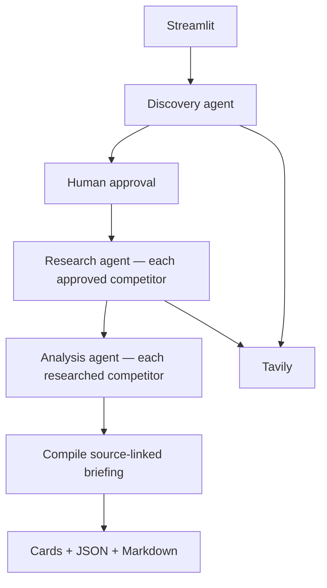

# Multi-Agent Competitor Research

A Streamlit app with three specialist agents, built with LangChain, LangGraph, OpenAI and Tavily.

## Setup

Install [uv](https://docs.astral.sh/uv/getting-started/installation/) first. From the `multi-agent-competitor-research` project folder, create or synchronize the environment:

```bash
uv sync --locked
```

If `.env` does not already exist, copy the example:

```bash
cp .env.example .env
```

For **Live** mode, set these values in `.env`:

```dotenv
OPENAI_API_KEY=your_openai_api_key
TAVILY_API_KEY=your_tavily_api_key
OPENAI_MODEL=gpt-4.1
```

Keep existing credentials if the project is already configured. `.env` and saved research data are excluded by `.gitignore`.

## Run

From the project folder:

```bash
uv run streamlit run app.py
```

1. Select **Live** for web research, or **Offline sample** to demonstrate the workflow with synthetic data and no API calls.
2. Enter a company or product and an optional market scope.
3. Select **Discover competitors**, review the shortlist, and choose **Approve and research**.
4. Review the comparison cards and source links, then download the JSON or Markdown briefing.

Use **Open a saved run** and its run ID to revisit results.

## Two application files

- **`app.py`** — output schemas, state, graph nodes and routing, each agent's prompt and implementation, saved runs, report formatting and Streamlit UI. Start at section 2 to follow the calls. Sections 4–6 contain the three agents.
- **`tavily_tools.py`** — `langchain_tavily.TavilySearch`, web/news tools, timeouts and bounded retries. It accepts the run's source store and never imports the app.

`tests/` contains automated checks.

## Flow



LangGraph routes from `WorkflowState` using the ordinary `next_step` function. Discovery, Research and Analysis each have their own prompt, tools and bounded `create_agent` loop. Competitors run sequentially. Approval and compilation are deterministic graph nodes. Completed steps are skipped when reopening a run.

Structured output flows through `run_specialist` → Pydantic validation → source/date validation → `build_report` → `finding_markdown`. If final output is malformed, one correction call gets the exact schema and existing source history. It cannot repeat searches. Invalid citations are omitted and shown as limitations.

## State and limits

Runs are stored in `data/runs/<run-id>/`: `settings.json`, `ledger.sqlite`, `checkpoints.sqlite`, and final `briefing.json`/`briefing.md`. Reopen a run using its ID. Approval, completed work and budgets survive restarts. Existing runs from the previous layout still open; legacy checkpoints are retained.

Budgets: four discovery searches, eight per approved competitor, 28 total; nine model calls per Research invocation (eight sequential searches plus the final response), eight for other specialists plus at most one format correction. News uses a saved six-calendar-month window. Use one active session per run.

A partial report explicitly retains missing data or failed stages. Source links provide traceability, not independent fact verification. Continue resumes unfinished graph work; completed failed specialist results remain recorded as gaps.

## Verify

```bash
uv run --locked python -m unittest discover -s tests -v
```

Tests cover state-driven routing without supervisor calls, approval/reopening, source validation, structured-output correction, mocked provider requests and the Streamlit UI. They use synthetic data or mocks and spend no API credits.

## Dependency management

`pyproject.toml` declares dependencies, `uv.lock` locks their resolved versions, and `.python-version` selects Python 3.12. Keep these files in version control; `.venv/`, credentials, and saved runs remain ignored. The separate `requirements.txt` is no longer used.

```bash
uv add package-name       # add a dependency and update the lockfile
uv remove package-name    # remove a dependency
uv lock --check           # check that the lockfile matches the project
uv build                  # build a wheel and source distribution in dist/
```

Dependency upgrades should be intentional: use `uv lock --upgrade-package package-name`, then run the tests.
